# GRPO group-size ablation

Tasks: countdown, knights_knaves, shortest_path. Runs: 9. Base-model val accuracy: –.

Values are mean ± std over seeds (std blank with one seed). Every step is 64 rollouts; G sets prompts per step (64/G). Arms that train for the same number of epochs therefore run different numbers of steps, rollouts, tokens and GPU-hours. The 'at equal ...' rows compare arms at the largest value of that axis that every arm reached.

## countdown

| metric | G=4 L4096 (n=1) | G=4 L2048 (n=1) | G=8 L4096 (n=1) |
|---|---|---|---|
| zero-std groups (TRL) | 0.545 | 0.595 | 0.460 |
| rollouts with signal | 0.455 | 0.405 | 0.540 |
| all-accepted groups | 0.265 | 0.243 | 0.297 |
| none-accepted groups | 0.302 | 0.389 | 0.183 |
| completion tokens / step | 1.8e+05 | 9.76e+04 | 1.62e+05 |
| weighted tokens total | 328,622,936 | 184,471,344 | 592,263,760 |
| GPU-hours (train steps) | 23.467 | 10.162 | 45.774 |
| GPU-hours (job) | 23.681 | 10.271 | 46.149 |
| step time (s) | 387.535 | 167.813 | 377.954 |
| length-capped share | 0.478 | 0.545 | 0.403 |
| optimizer steps | 218 | 218 | 436 |
| epochs over train prompts | 1.993 | 1.993 | 1.993 |
| rollouts | 13,952 | 13,952 | 27,904 |
| train correctness, first 50 steps | 0.367 | 0.249 | 0.353 |
| train correctness, last 50 steps | 0.541 | 0.493 | 0.632 |
| train correctness at equal epochs | 0.496 | 0.467 | 0.586 |
| train correctness at equal rollouts | 0.496 | 0.467 | 0.652 |
| train correctness at equal tokens | 0.496 | 0.467 | 0.590 |
| train correctness at equal GPU-hours | 0.496 | 0.467 | 0.648 |

## knights_knaves

| metric | G=4 L4096 (n=1) | G=4 L2048 (n=1) | G=8 L4096 (n=1) |
|---|---|---|---|
| zero-std groups (TRL) | 0.827 | 0.715 | 0.863 |
| rollouts with signal | 0.173 | 0.285 | 0.137 |
| all-accepted groups | 0.826 | 0.709 | 0.863 |
| none-accepted groups | 0.001 | 0.009 | 0 |
| completion tokens / step | 1.03e+05 | 4.76e+04 | 5.75e+04 |
| weighted tokens total | 193,959,256 | 97,307,040 | 228,960,392 |
| GPU-hours (train steps) | 19.192 | 8.267 | 26.548 |
| GPU-hours (job) | 19.371 | 8.368 | 26.813 |
| step time (s) | 316.930 | 136.518 | 219.207 |
| length-capped share | 0.020 | 0.055 | 0.006 |
| optimizer steps | 218 | 218 | 436 |
| epochs over train prompts | 1.993 | 1.993 | 1.993 |
| rollouts | 13,952 | 13,952 | 27,904 |
| train correctness, first 50 steps | 0.835 | 0.675 | 0.838 |
| train correctness, last 50 steps | 0.981 | 0.976 | 0.994 |
| train correctness at equal epochs | 0.975 | 0.980 | 0.998 |
| train correctness at equal rollouts | 0.975 | 0.980 | 0.992 |
| train correctness at equal tokens | 0.975 | 0.980 | 0.993 |
| train correctness at equal GPU-hours | 0.975 | 0.980 | 0.992 |

## shortest_path

| metric | G=4 L4096 (n=1) | G=4 L2048 (n=1) | G=8 L4096 (n=1) |
|---|---|---|---|
| zero-std groups (TRL) | 0.583 | 0.545 | 0.554 |
| rollouts with signal | 0.417 | 0.455 | 0.446 |
| all-accepted groups | 0.438 | 0.335 | 0.515 |
| none-accepted groups | 0.145 | 0.213 | 0.039 |
| completion tokens / step | 1.5e+05 | 7.41e+04 | 1.28e+05 |
| weighted tokens total | 288,895,656 | 155,614,256 | 497,778,096 |
| GPU-hours (train steps) | 23.143 | 9.951 | 43.081 |
| GPU-hours (job) | 23.345 | 10.064 | 43.448 |
| step time (s) | 382.176 | 164.331 | 355.718 |
| length-capped share | 0.246 | 0.255 | 0.117 |
| optimizer steps | 218 | 218 | 436 |
| epochs over train prompts | 1.993 | 1.993 | 1.993 |
| rollouts | 13,952 | 13,952 | 27,904 |
| train correctness, first 50 steps | 0.330 | 0.168 | 0.337 |
| train correctness, last 50 steps | 0.836 | 0.792 | 0.885 |
| train correctness at equal epochs | 0.805 | 0.797 | 0.867 |
| train correctness at equal rollouts | 0.805 | 0.797 | 0.910 |
| train correctness at equal tokens | 0.805 | 0.797 | 0.874 |
| train correctness at equal GPU-hours | 0.805 | 0.797 | 0.909 |

countdown: equal-budget points are epochs [G=4 L4096/G=8 L4096] = 1.99, epochs [G=4 L2048] = 1.99, rollouts [G=4 L4096/G=8 L4096] = 1.4e+04, rollouts [G=4 L2048] = 1.4e+04, completion tokens [G=4 L4096/G=8 L4096] = 3.93e+07, completion tokens [G=4 L2048] = 2.13e+07, GPU-hours [G=4 L4096/G=8 L4096] = 23.5, GPU-hours [G=4 L2048] = 10.2.
knights_knaves: equal-budget points are epochs [G=4 L4096/G=8 L4096] = 1.99, epochs [G=4 L2048] = 1.99, rollouts [G=4 L4096/G=8 L4096] = 1.4e+04, rollouts [G=4 L2048] = 1.4e+04, completion tokens [G=4 L4096/G=8 L4096] = 2.25e+07, completion tokens [G=4 L2048] = 1.04e+07, GPU-hours [G=4 L4096/G=8 L4096] = 19.2, GPU-hours [G=4 L2048] = 8.27.
shortest_path: equal-budget points are epochs [G=4 L4096/G=8 L4096] = 1.99, epochs [G=4 L2048] = 1.99, rollouts [G=4 L4096/G=8 L4096] = 1.4e+04, rollouts [G=4 L2048] = 1.4e+04, completion tokens [G=4 L4096/G=8 L4096] = 3.28e+07, completion tokens [G=4 L2048] = 1.61e+07, GPU-hours [G=4 L4096/G=8 L4096] = 23.1, GPU-hours [G=4 L2048] = 9.95.

## Figures

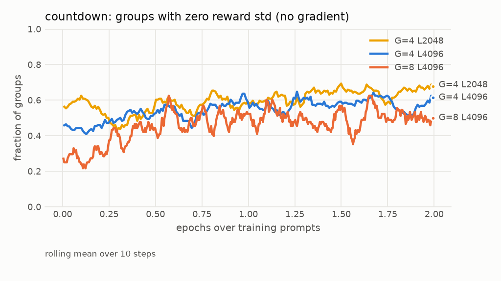
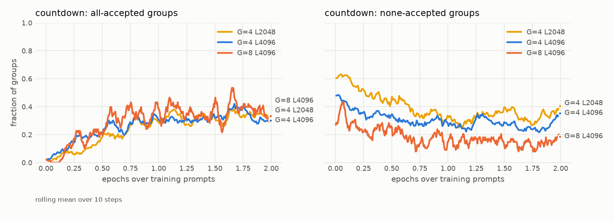
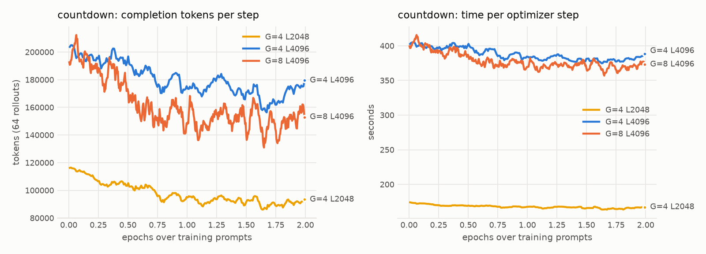
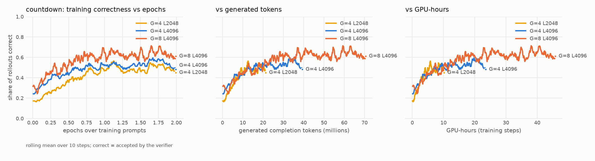
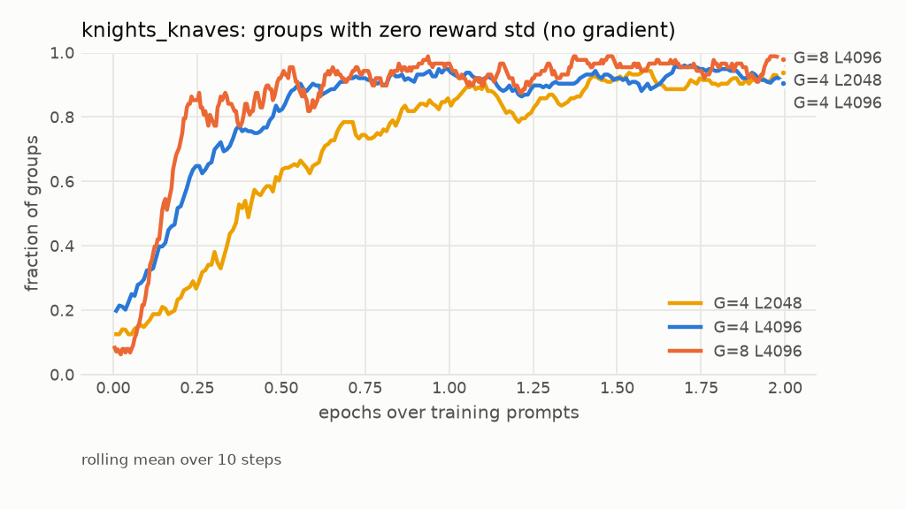
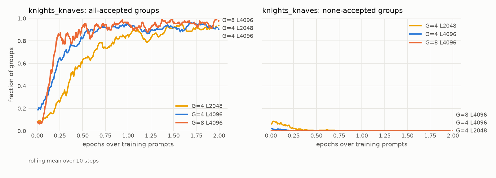
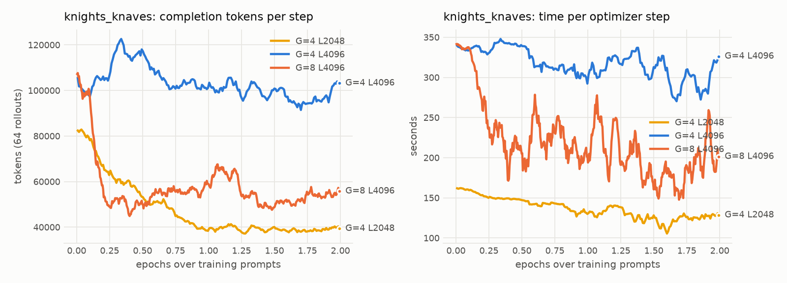
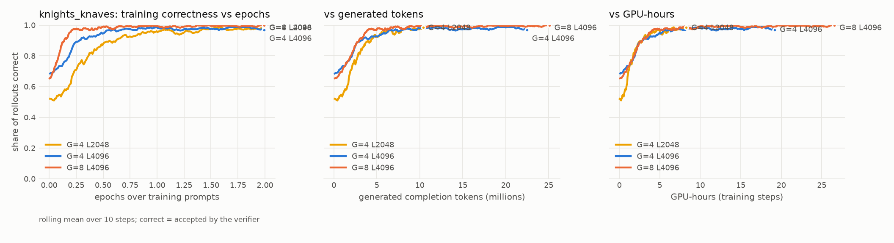
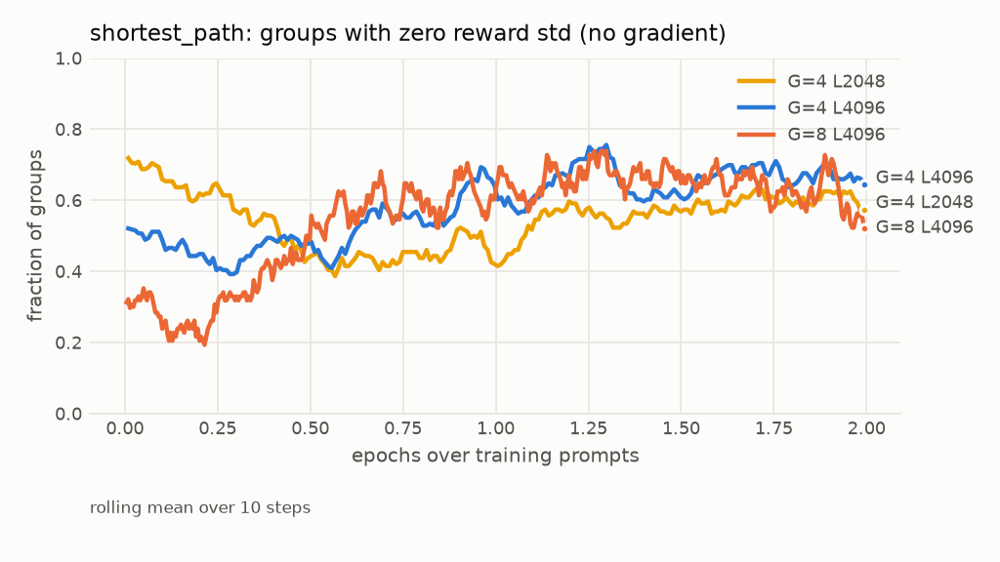
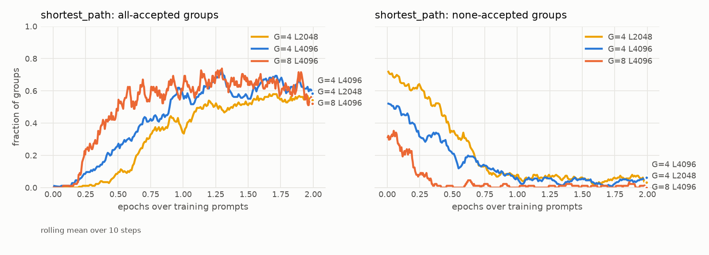
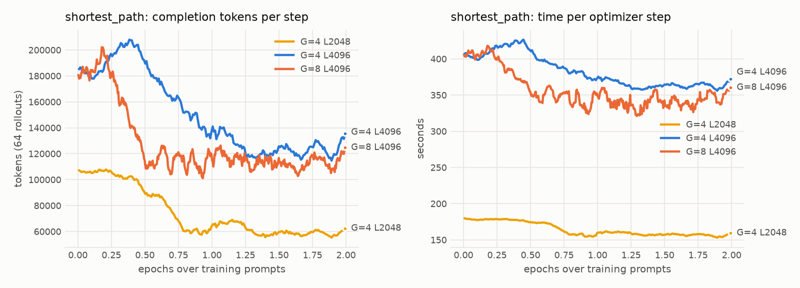
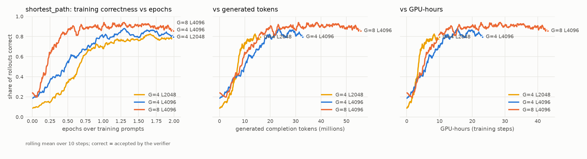

## Runs

| run | task | arm | seed | steps | final acc | GPU-h | notes |
|---|---|---|---|---|---|---|---|
| countdown-G4-L2048-2ep-13618458 | countdown | G=4 L2048 | None | 218 | – | 10.162 | no checkpoint evals (val_n500.json) |
| countdown-G4-L4096-2ep-13618452 | countdown | G=4 L4096 | None | 218 | – | 23.467 | no checkpoint evals (val_n500.json) |
| countdown-G8-L4096-2ep-13618454 | countdown | G=8 L4096 | None | 436 | – | 45.774 | no checkpoint evals (val_n500.json) |
| knights_knaves-G4-L2048-2ep-13618466 | knights_knaves | G=4 L2048 | None | 218 | – | 8.267 | no checkpoint evals (val_n500.json) |
| knights_knaves-G4-L4096-2ep-13618460 | knights_knaves | G=4 L4096 | None | 218 | – | 19.192 | no checkpoint evals (val_n500.json) |
| knights_knaves-G8-L4096-2ep-13618462 | knights_knaves | G=8 L4096 | None | 436 | – | 26.548 | no checkpoint evals (val_n500.json) |
| shortest_path-G4-L2048-2ep-13618474 | shortest_path | G=4 L2048 | None | 218 | – | 9.951 | no checkpoint evals (val_n500.json) |
| shortest_path-G4-L4096-2ep-13618468 | shortest_path | G=4 L4096 | None | 218 | – | 23.143 | no checkpoint evals (val_n500.json) |
| shortest_path-G8-L4096-2ep-13618470 | shortest_path | G=8 L4096 | None | 436 | – | 43.081 | no checkpoint evals (val_n500.json) |

## Missing inputs

- no --baseline-dir: no base accuracy, predictions or buckets
